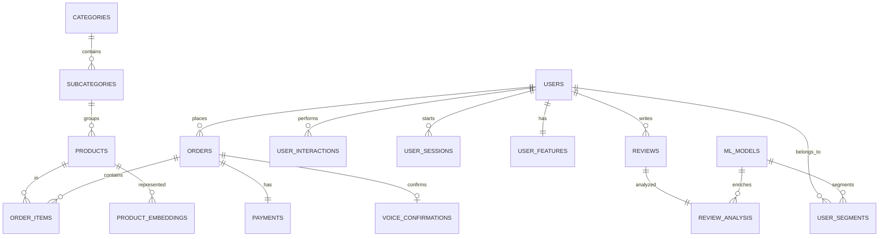

# 🚀 E-Commerce Intelligent Platform (Backend & ML Architecture)

Bienvenue dans l'architecture Backend et Data de la plateforme e-commerce intelligente. Ce projet est un environnement **hybride** mêlant logique métier (CRUD) et pipeline analytique (Machine Learning).

---

## 🏗️ Architecture du Projet

### 1. Topologie des Dossiers
- **`backend/src/sql/`** : Source de vérité du schéma (001-008). Idempotent et versionné.
- **`backend/src/services/`** : Logique métier et pont vers les scripts ML (`ml.service.ts`).
- **`ml/seed_data.py`** : Point d'entrée du générateur de données synthétiques.
- **`ml/seeder/`** : Package modulaire (config, catalog, core) pour la génération massive de données.
- **`ml/data/`** : Scripts SQL analytiques (ex: `upsert_user_features.sql`).

### 2. Schéma Relationnel (ERD) & Cardinalités
Cette structure permet de passer d'une transaction client à un modèle de segmentation IA.



---

## 🔐 Sécurité & Hachage
Le système utilise **Bcrypt** (12 rounds) pour protéger les mots de passe.
- **Utilisateurs Seed** : Tous les comptes générés ont le mot de passe `password123`.
- **Backend** : Utilitaire `password.ts` disponible pour le hash/compare.

---

## 💾 Guide d'Exécution (Commandes)

| Action | Commande | Description |
| :--- | :--- | :--- |
| **Setup SQL** | `npm run db:init` | Initialise tables, triggers et contraintes (Force-refresh). |
| **Seeding Reset** | `npm run ml:seed:reset` | Vide la base et génère 18 mois d'historique (Mode paid). |
| **Seeding Add** | `npm run ml:seed:append` | Ajoute des données sans effacer l'existant. |
| **ML Snapshot** | `npm run ml:upsert-features` | Persiste les features utilisateurs pour l'IA. |
| **Dev Server** | `npm run dev` | Lance l'API Express sur le port 3000. |

---

## 🧠 Le Pont ML (`Upsert`)
Le "Secret Sauce" est le **Feature Persistence Layer** :
1. Les actions utilisateurs (clics, orders) sont capturées en temps réel.
2. La vue `v_user_behavior_features` agrège ces comportements.
3. `npm run ml:upsert-features` fige ces stats dans `user_features` pour l'entraînement des modèles.

---

## 🐘 Commandes PostgreSQL & Docker (Accès Direct à la Base)

> Ces commandes permettent d'interagir **directement** avec la base de données PostgreSQL qui tourne dans le conteneur Docker `ecommerce_postgres`.
> Elles sont utiles pour le **debug**, la **vérification des données** après le seeding, ou simplement pour explorer le schéma.

### 📌 Pré-requis

Avant d'exécuter ces commandes, assurez-vous que :
1. **Docker Desktop** est lancé et en cours d'exécution.
2. Le conteneur `ecommerce_postgres` est **actif** (icône verte dans Docker Desktop ou vérifiez avec `docker ps`).
3. Vous êtes dans un **terminal** (PowerShell, CMD ou Git Bash).

```bash
# Vérifier que le conteneur tourne bien
docker ps
# Vous devriez voir une ligne avec "ecommerce_postgres" dans la colonne NAMES
```

---

### 🔌 Se connecter à PostgreSQL (mode interactif)

Ouvre une session `psql` interactive. Vous pouvez y taper des requêtes SQL librement.

```bash
docker exec -it ecommerce_postgres psql -U postgres -d ecommerce_ml_db
```

| Paramètre | Signification |
| :--- | :--- |
| `docker exec -it` | Exécute une commande **dans** le conteneur en mode interactif (terminal) |
| `ecommerce_postgres` | Nom du conteneur Docker qui héberge PostgreSQL |
| `psql` | Client en ligne de commande de PostgreSQL |
| `-U postgres` | Se connecter avec l'utilisateur `postgres` (superadmin) |
| `-d ecommerce_ml_db` | Se connecter à la base de données `ecommerce_ml_db` |

> **💡 Pour quitter psql** : tapez `\q` puis Entrée.

---

### 🔍 Commandes d'exploration (mode non-interactif)

Ces commandes s'exécutent en **une seule ligne** depuis votre terminal (pas besoin d'entrer dans psql).

#### 📋 Lister toutes les tables de la base

```bash
docker exec -it ecommerce_postgres psql -U postgres -d ecommerce_ml_db -c "\dt"
```

> **Explication** : `\dt` est une commande psql qui affiche toutes les tables du schéma `public`.
> Le flag `-c` permet de passer une commande à `psql` sans ouvrir une session interactive.

#### 🗄️ Lister toutes les bases de données disponibles

```bash
docker exec -it ecommerce_postgres psql -U postgres -c "\l"
```

> **Explication** : `\l` liste toutes les bases de données sur le serveur PostgreSQL.
> Vous devriez voir `ecommerce_ml_db` dans la liste.

#### ✅ Tester que PostgreSQL répond correctement

```bash
docker exec -it ecommerce_postgres psql -U postgres -d ecommerce_ml_db -c "SELECT NOW();"
```

> **Explication** : `SELECT NOW()` retourne la date et l'heure actuelles du serveur.
> Si vous obtenez un résultat avec une date, **la connexion fonctionne** ✅.

---

### 📊 Vérifier que les tables sont remplies (après le seeding)

Après avoir exécuté `npm run ml:seed:reset`, utilisez ces commandes pour vérifier que les données ont bien été insérées :

```bash
# Compter les utilisateurs
docker exec -it ecommerce_postgres psql -U postgres -d ecommerce_ml_db -c "SELECT COUNT(*) FROM users;"

# Compter les produits
docker exec -it ecommerce_postgres psql -U postgres -d ecommerce_ml_db -c "SELECT COUNT(*) FROM products;"

# Compter les commandes
docker exec -it ecommerce_postgres psql -U postgres -d ecommerce_ml_db -c "SELECT COUNT(*) FROM orders;"

# Compter les interactions utilisateurs
docker exec -it ecommerce_postgres psql -U postgres -d ecommerce_ml_db -c "SELECT COUNT(*) FROM user_interactions;"

# Compter les avis clients
docker exec -it ecommerce_postgres psql -U postgres -d ecommerce_ml_db -c "SELECT COUNT(*) FROM reviews;"

# Compter les paiements
docker exec -it ecommerce_postgres psql -U postgres -d ecommerce_ml_db -c "SELECT COUNT(*) FROM payments;"
```

> **Résultat attendu** : Chaque table devrait contenir plusieurs centaines ou milliers de lignes après un seeding réussi.

#### 🔎 Voir un aperçu des données (5 premières lignes)

```bash
# Aperçu des utilisateurs
docker exec -it ecommerce_postgres psql -U postgres -d ecommerce_ml_db -c "SELECT * FROM users LIMIT 5;"

# Aperçu des produits
docker exec -it ecommerce_postgres psql -U postgres -d ecommerce_ml_db -c "SELECT * FROM products LIMIT 5;"

# Aperçu des features ML
docker exec -it ecommerce_postgres psql -U postgres -d ecommerce_ml_db -c "SELECT * FROM user_features LIMIT 5;"
```

---

### 🛠️ Astuces utiles dans psql (mode interactif)

Si vous êtes en session interactive (`docker exec -it ... psql ...`), voici des commandes utiles :

| Commande psql | Action |
| :--- | :--- |
| `\dt` | Lister toutes les tables |
| `\d nom_table` | Voir la structure d'une table (colonnes, types, contraintes) |
| `\dv` | Lister toutes les vues (views) |
| `\l` | Lister toutes les bases de données |
| `\pset pager off` | **Désactiver le pager** (évite le message `-- More --` ou `END`) |
| `\x` | Activer/désactiver l'affichage étendu (vertical) |
| `\q` | **Quitter** psql et revenir au terminal |
| `\?` | Afficher l'aide de toutes les commandes psql |

> **⚠️ Astuce importante** : Si vous voyez `(END)` ou `-- More --` en bas de l'écran, appuyez sur la touche **`q`** pour revenir à l'invite.
> Pour éviter ce problème, exécutez `\pset pager off` dès que vous entrez dans psql.

---

### 🚨 Résolution de problèmes courants

| Problème | Cause probable | Solution |
| :--- | :--- | :--- |
| `Error: No such container: ecommerce_postgres` | Le conteneur n'est pas lancé | Lancez `docker-compose up -d` depuis la racine du projet |
| `FATAL: database "ecommerce_ml_db" does not exist` | La base n'a pas été créée | Exécutez `npm run db:init` pour initialiser le schéma |
| `FATAL: password authentication failed` | Mauvais mot de passe | Vérifiez la variable `POSTGRES_PASSWORD` dans `docker-compose.yml` |
| `relation "users" does not exist` | Les tables n'ont pas été créées | Exécutez `npm run db:init` puis `npm run ml:seed:reset` |
| Résultats vides (`count = 0`) | Le seeding n'a pas été lancé | Exécutez `npm run ml:seed:reset` pour générer les données |

---

## 🛠️ Maintenance & Mise à jour
- **Vocabulaire Status** : Les status (`paid`, `refunded`, etc.) sont désormais forcés dans le schéma via `002_constraints.sql`. Si vous changez le vocabulaire, relancez `npm run db:init`.
- **Ajout de Données** : Pour modifier les produits ou avis, intervenez directement dans `ml/seeder/catalog.py` ou `ml/seeder/generators.py`.

---
**[ 🛑 Document consolidé le 02 Avril 2026 ]**
