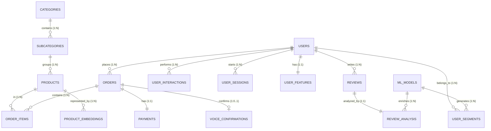

# 🚀 E-Commerce Intelligent Platform (Backend & ML Architecture)

Bienvenue dans l'architecture Backend et Data de la plateforme e-commerce intelligente. Ce projet est un environnement **hybride** mêlant logique métier (CRUD) et pipeline analytique (Machine Learning).

---

## 🏗️ Architecture du Projet

### 1. Topologie des Dossiers
- **`backend/src/sql/`** : Source de vérité du schéma (001-008). Idempotent et versionné.
- **`backend/src/services/`** : Logique métier et pont vers les scripts ML (`ml.service.ts`).
- **`ml/seed_data.py`** : Point d'entrée du générateur de données synthétiques.
- **`ml/seeder/`** : Package modulaire (config, catalog, core) pour la génération massive de données.
- **`ml/data/`** : Scripts SQL analytiques (ex: `upsert_user_features.sql`).

### 2. Schéma Relationnel (ERD) & Cardinalités
Cette structure permet de passer d'une transaction client à un modèle de segmentation IA.

---

## 🔐 Sécurité & Hachage
Le système utilise **Bcrypt** (12 rounds) pour protéger les mots de passe.
- **Utilisateurs Seed** : Tous les comptes générés ont le mot de passe `password123`.
- **Backend** : Utilitaire `password.ts` disponible pour le hash/compare.

---

## 💾 Guide d'Exécution (Commandes)

| Action | Commande | Description |
| :--- | :--- | :--- |
| **Setup SQL** | `npm run db:init` | Initialise tables, triggers et contraintes (Force-refresh). |
| **Seeding Reset** | `npm run ml:seed:reset` | Vide la base et génère 18 mois d'historique (Mode paid). |
| **Seeding Add** | `npm run ml:seed:append` | Ajoute des données sans effacer l'existant. |
| **ML Snapshot** | `npm run ml:upsert-features` | Persiste les features utilisateurs pour l'IA. |
| **Dev Server** | `npm run dev` | Lance l'API Express sur le port 3000. |

---

## 🧠 Le Pont ML (`Upsert`)
Le "Secret Sauce" est le **Feature Persistence Layer** :
1. Les actions utilisateurs (clics, orders) sont capturées en temps réel.
2. La vue `v_user_behavior_features` agrège ces comportements.
3. `npm run ml:upsert-features` fige ces stats dans `user_features` pour l'entraînement des modèles.

---

## 🛠️ Maintenance & Mise à jour
- **Vocabulaire Status** : Les status (`paid`, `refunded`, etc.) sont désormais forcés dans le schéma via `002_constraints.sql`. Si vous changez le vocabulaire, relancez `npm run db:init`.
- **Ajout de Données** : Pour modifier les produits ou avis, intervenez directement dans `ml/seeder/catalog.py` ou `ml/seeder/generators.py`.

---
**[ 🛑 Document consolidé le 21 Mars 2026 ]**
