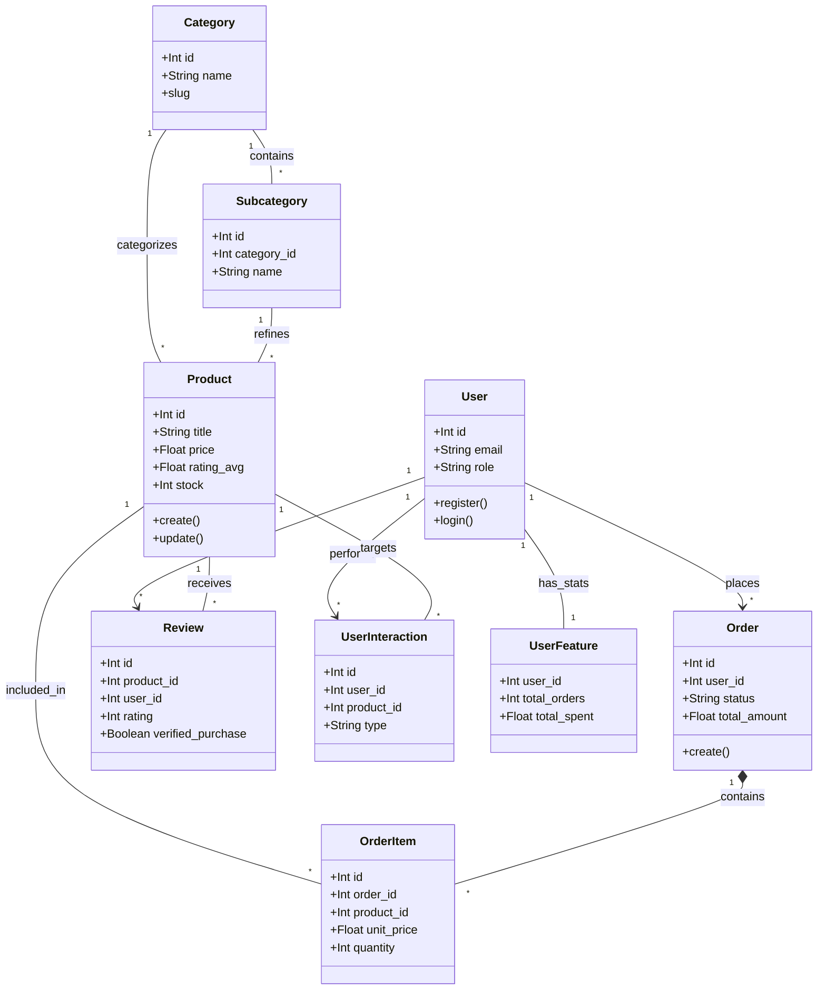

# 🚀 E-Commerce Intelligent Platform (Backend & Machine Learning Hybride)

Bienvenue dans l'architecture Backend et Intelligence Artificielle de la plateforme e-commerce. Ce projet est un environnement **hybride** mêlant logique métier stricte (Node.js) et pipeline de requêtes sémantiques ou génératives (Python FastAPI / LLMs / Algorithmes).

---

## 🏗️ Architecture du Projet

Le système s'articule autour de 3 piliers majeurs :

### 1. Backend API (Node.js / Express) dans `backend/`
- **`src/sql/`** : Source de vérité du schéma (001-010). Idempotent, contenant des configurations avancées et des tables spécifiques (`product_embeddings`, `chatbot_interactions`).
- **`src/services/`** : Logique métier (Commandes, Avis, etc.) dissociée des contrôleurs.
- **Sécurité et Scalabilité** : Zod pour la validation, JWT, Bcrypt, Helmet, et Rate Limiting centralisés.

### 2. Service NLP & APIs ML (Python / FastAPI) dans `ml/`
- **`api/main.py`** : Serveur d'inférence (FastAPI) écoutant sur le port 8000. Point d'entrée pour le Chatbot documentaire (endpoint `/chat`).
- **`nlp/chatbot/`** : Agent **RAG (Retrieval-Augmented Generation)** qui synthétise les recommandations produits en interrogeant la LLM (OpenAI par défaut). 
- **`nlp/retrieval/`** : Moteurs d'extraction hybride configurés pour interroger la base :
  - *DenseVectoreRetriever* : Recherche Sémantique par similarité Cosinus (via l'extension PostgreSQL `pgvector`).
  - *BM25Retriever* : Recherche Lexicale exacte.
- **`nlp_experiments/`** : Scripts d'automatisation des tests et benchmarks QA des modèles (Performance, Non-Regression, Overfitting).

### 3. Base de Données Hybride (PostgreSQL)
Fournie via Docker (`ecommerce_postgres`), la base intègre l'extension **pgvector** (`pgvector/pgvector:pg16`). Elle assure à la fois du transactionnel classique (Orders) et du stockage de vecteurs (Embeddings de 384 dimensions).

---

## 🏗️ Architecture des Données & Relations (Class Diagram)

L'architecture suit un modèle orienté services avec une forte intégrité relationnelle en base de données.


_Note: Les cardinalités assurent qu'un produit peut exister sans avis, mais un avis doit être lié à un produit et un utilisateur existants._

---

## 🎯 Traçabilité RAG & ML
Cette architecture ne se contente pas de stocker des ventes, elle capture tout le processus décisionnel IA via les interactions et les métadonnées sémantiques.


---

## 💾 Guide d'Exécution & Déploiement Local

### Étape 1 : Infrastructure
Démarrez la base de données (qui inclut nativement `pgvector`) :
```bash
cd backend/infra/docker
docker-compose up -d
```

### Étape 2 : Initialisation du Backend (Environnement Transactionnel)
```bash
cd backend
npm install
npm run db:init # ⚠️ Force-refresh : Réinstalle les 10 schémas SQL incluant les tables IA !
npm run dev     # Lance le backend Node.js (ex: http://localhost:5000)
```
_Astuce : Exécutez `npm run ml:seed:reset` depuis le package.json pour la génération automatisée initiale du catalogue._

### Étape 3 : Initialisation du Service ML (FastAPI & Agent)
```bash
cd ml
# Recommandé: Créez un Virtual Environnement
pip install -r requirements.txt
```

**⚠️ Configuration IA (Variable d'Environnement) :**
Pour que le Chatbot puisse répondre, configurez la clé OpenAI :
- **Windows PowerShell :** `$env:OPENAI_API_KEY="sk-votre-cle"`
- **Linux/Mac :** `export OPENAI_API_KEY="sk-votre-cle"`
*(Si la clé est absente, l'API passera en mode DÉMO sécurisé sans crasher).*

```bash
# Lancement de l'API ML
python api/main.py
```

---

## 🛡️ Audit de Qualité & Finalisation Backend (Avril 2026)

Le système a subi une phase de finalisation intensive et un audit technique complet pour passer d'un prototype à une version de production :

1. **Finalisation des APIs Node.js** :
   - **Catalogue Complet** : Gestion CRUD avancée pour Produits, Catégories et Sous-catégories avec auto-slugification unique.
   - **Système de Commandes Transactionnel** : Gestion atomique des stocks, des paiements et des snapshots de produits (prévention des race conditions via `FOR UPDATE`).
   - **Reviews & Ratings** : Système d'avis sécurisé avec vérification automatique des achats (`verified_purchase`) et recalcul temps réel des notes moyennes.
   - **Auth & RBAC** : Authentification JWT sécurisée par cookies `httpOnly` et gestion stricte des rôles (`admin`, `customer`).

2. **Collecte de Données pour l'IA (Data Capture)** :
   - **Interaction Logging** : Chaque action utilisateur (`view`, `purchase`, `review`) est désormais capturée dans la table `user_interactions`. 
   - **Alimentation ML** : Ces signaux enrichissent en temps réel le profil utilisateur pour les futurs modèles de recommandation et de segmentation.

3. **Sécurité & Robustesse** :
   - **Middlewares Défensifs** : Helmet, Morgan, Rate Limiting, et validation Zod systématique sur chaque point d'entrée.
   - **Gestion des Erreurs** : Centralisation via une classe `AppError` et un middleware global pour des réponses API normalisées.
   - **Audit Report** : Un rapport complet (`BACKEND_AUDIT_REPORT.md`) détaille les choix architecturaux et les garanties de sécurité.

4. **Pipeline RAG Optimisé** : 
   - **Précision Lexicale** : Logique `AND` pour le BM25.
   - **Richesse du Contexte** : Fenêtre contextuelle étendue pour des réponses IA plus techniques.
   - **Sécurité Agent** : Protection contre le prompt injection.

---

## 🧪 Maintenance, Tests & Évaluation

Pour garantir la qualité continue du service ML, utilisez les commandes suivantes depuis la racine du projet :

### 1. Exécution du Service
```bash
# Lancer l'API FastAPI (Inférence Chatbot)
python ml/api/main.py
```

### 2. Tests QA & Validation
```bash
# Lancer la suite de tests complète (Pydantic, Injections, Scénarios)
pytest ml/test_chat.py -v

# Lancer l'outil d'évaluation QA automatisé (génère un rapport détaillé)
python ml/nlp_experiments/chatbot_qa_tester.py
```

### 3. Gestion des Données & Embeddings
```bash
# Vérifier l'état de la base de données et des extensions (pgvector)
python ml/scripts/health_check_db.py

# (Re)Générer les embeddings vectoriels pour tout le catalogue
python ml/scripts/generate_embeddings.py

# Reset complet et seeding du catalogue (Node.js)
npm run ml:seed:reset
```

## 🛠️ Dépannage (Troubleshooting)

### Erreur `getaddrinfo failed` au lancement de `main.py`
Si vous obtenez une erreur de connexion lors du premier lancement :
- **Cause** : Le script tente de télécharger le modèle de langage (`paraphrase-multilingual-MiniLM-L12-v2`) depuis Hugging Face.
- **Solution** : Vérifiez votre connexion internet. Une fois téléchargé, le modèle est mis en cache localement et ne nécessite plus d'internet.

### Erreur de Port (5433)
Si le service ML ne se connecte pas à la DB :
- Vérifiez que Docker est lancé (`docker-compose ps`).
- Le port par défaut est **5433** (mappage Docker). Si vous utilisez un Postgres local sans Docker, changez `DB_PORT=5432` dans le fichier `.env`.

---

> [!TIP]
> Avant de déployer une modification sur le `System Prompt`, exécutez systématiquement `pytest ml/test_chat.py` pour vérifier que les garde-fous contre les injections sont toujours actifs.

---

> [!NOTE]
> Pour des questions pointues concernant le stockage vectoriel ou les expérimentations algorithmiques, consultez le dossier expérimental `ml/nlp_experiments/` ou le guide détaillé `ml/docs/CHATBOT_PIPELINE.md`.
