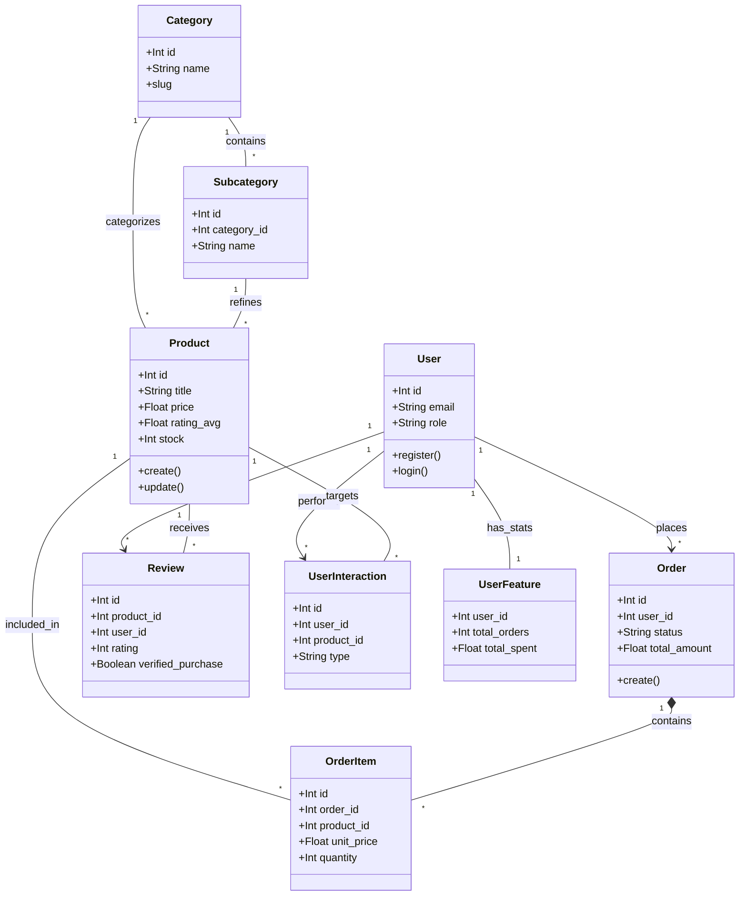
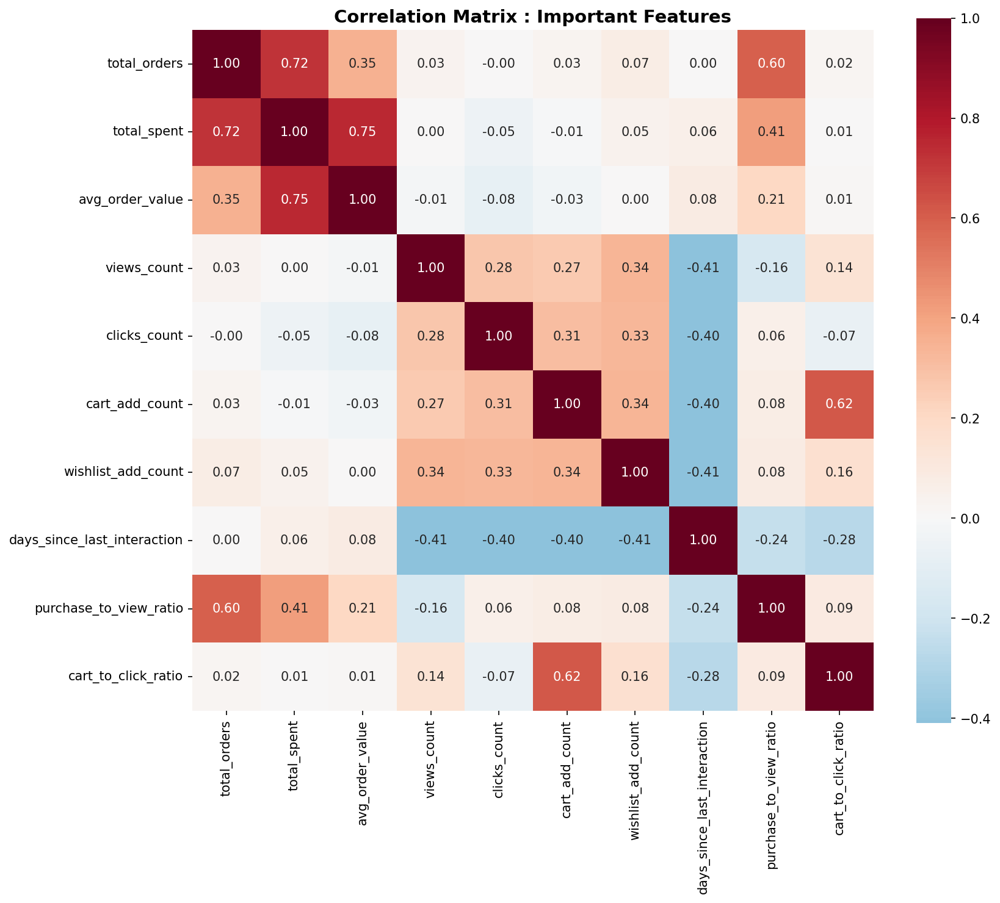
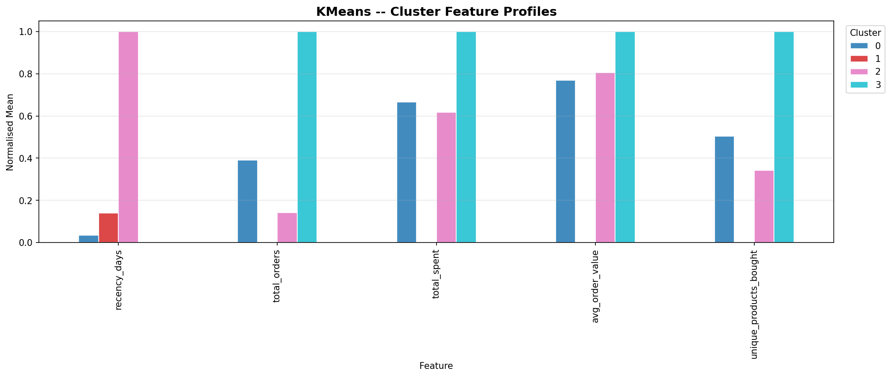
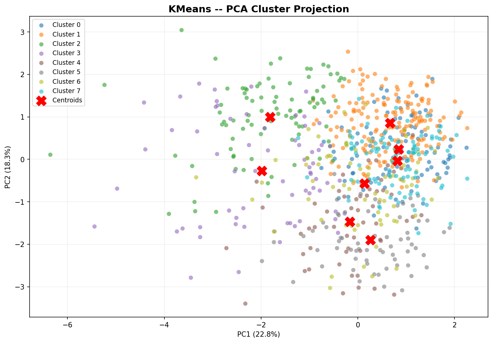
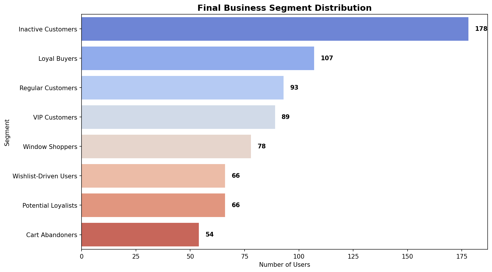

# 🚀 E-Commerce Intelligent Platform (Backend & Machine Learning Hybride)

Bienvenue dans l'architecture Backend et Intelligence Artificielle de la plateforme e-commerce. Ce projet est un environnement **hybride** mêlant logique métier stricte (Node.js) et pipeline de requêtes sémantiques ou génératives (Python FastAPI / LLMs / Algorithmes).

---

## 🏗️ Architecture du Projet

Le système s'articule autour de 3 piliers majeurs :

### 1. Backend API (Node.js / Express) dans `backend/`
- **`src/sql/`** : Source de vérité du schéma (001-010). Idempotent, contenant des configurations avancées et des tables spécifiques (`product_embeddings`, `chatbot_interactions`).
- **`src/services/`** : Logique métier (Commandes, Avis, etc.) dissociée des contrôleurs.
- **Sécurité et Scalabilité** : Zod pour la validation, JWT, Bcrypt, Helmet, et Rate Limiting centralisés.

### 2. Service NLP & APIs ML (Python / FastAPI) dans `ml/`
- **`api/main.py`** : Serveur d'inférence (FastAPI) écoutant sur le port 8000. Point d'entrée pour le Chatbot documentaire (endpoint `/chat`).
- **`nlp/chatbot/`** : Agent **RAG (Retrieval-Augmented Generation)** qui synthétise les recommandations produits en interrogeant la LLM (OpenAI par défaut). 
- **`nlp/retrieval/`** : Moteurs d'extraction hybride configurés pour interroger la base :
  - *DenseVectoreRetriever* : Recherche Sémantique par similarité Cosinus (via l'extension PostgreSQL `pgvector`).
  - *BM25Retriever* : Recherche Lexicale exacte.
- **`customer_segmentation/`** : Pipeline MLOps pour le clustering des utilisateurs (RFM + Engagement) :
  - *Algorithmes* : K-Means, Gaussian Mixture (GMM), DBSCAN.
  - *Profiling* : Interprétation automatique des segments pour le marketing.
- **`nlp_experiments/`** : Scripts d'automatisation des tests et benchmarks QA des modèles.

### 3. Base de Données Hybride (PostgreSQL)
Fournie via Docker (`ecommerce_postgres`), la base intègre l'extension **pgvector** (`pgvector/pgvector:pg16`). Elle assure à la fois du transactionnel classique (Orders) et du stockage de vecteurs (Embeddings de 384 dimensions).

---

## 🏗️ Architecture des Données & Relations (Class Diagram)

L'architecture suit un modèle orienté services avec une forte intégrité relationnelle en base de données.


_Note: Les cardinalités assurent qu'un produit peut exister sans avis, mais un avis doit être lié à un produit et un utilisateur existants._

---

## 🎯 Traçabilité RAG & ML
Cette architecture ne se contente pas de stocker des ventes, elle capture tout le processus décisionnel IA via les interactions et les métadonnées sémantiques.


---

## 💾 Guide d'Exécution & Déploiement Local

### Étape 1 : Infrastructure
Démarrez la base de données (qui inclut nativement `pgvector`) :
```bash
cd backend/infra/docker
docker-compose up -d
```

### Étape 2 : Initialisation du Backend (Environnement Transactionnel)
```bash
cd backend
npm install
npm run db:init # ⚠️ Force-refresh : Réinstalle les 10 schémas SQL incluant les tables IA !
npm run dev     # Lance le backend Node.js (ex: http://localhost:5000)
```
_Astuce : Exécutez `npm run ml:seed:reset` depuis le package.json pour la génération automatisée initiale du catalogue._

### Étape 3 : Initialisation du Service ML (FastAPI & Agent)
```bash
cd ml
# Recommandé: Créez un Virtual Environnement
pip install -r requirements.txt
```

**⚠️ Configuration IA (Variable d'Environnement) :**
Pour que le Chatbot puisse répondre, configurez la clé OpenAI :
- **Windows PowerShell :** `$env:OPENAI_API_KEY="sk-votre-cle"`
- **Linux/Mac :** `export OPENAI_API_KEY="sk-votre-cle"`
*(Si la clé est absente, l'API passera en mode DÉMO sécurisé sans crasher).*

```bash
# Lancement de l'API ML
python api/main.py
```

---

## 📊 Segmentation & Intelligence Marketing 

Le système intègre un pipeline complet de segmentation client pour transformer les données brutes en segments actionnables.

### 1. Caractéristiques (Features) extraites :
Le pipeline calcule automatiquement des indicateurs **RFM (Récence, Fréquence, Montant)** ainsi que des scores d'engagement :
- `recency_days`, `total_orders`, `total_spent`.
- `views_count`, `clicks_count`, `cart_add_count`.
- `purchase_to_view_ratio` (Taux de conversion).

### 2. Algorithmes disponibles :
- **K-Means** : Clustering basé sur la distance Euclidienne (avec méthode Elbow/Silhouette).
- **GMM (Gaussian Mixture Model)** : Clustering probabiliste pour des segments aux formes complexes.
- **DBSCAN** : Détection de clusters basée sur la densité (idéal pour identifier les outliers).

### 3. Exécution du Pipeline :
Depuis la racine :
```bash
# Exécuter tous les modèles et comparer le meilleur
python -m ml.customer_segmentation.run_pipeline

# Exécuter des modèles spécifiques (ex: K-Means et GMM)
python -m ml.customer_segmentation.run_pipeline --models kmeans gmm

# Forcer la synchronisation avec la base de données
python -m ml.customer_segmentation.run_pipeline --force-reload
```

### 4. Visualisation des Résultats :
Voici les graphiques clés pour interpréter les segments identifiés par le modèle **K-Means** :

#### A. Matrice de Corrélation
Explique comment les différentes variables (Dépenses, Commandes, Engagement) sont liées entre elles.


#### B. Profils des Segments (Clustering)
Affiche les caractéristiques moyennes de chaque groupe (ex: Panier moyen, Récence). C'est l'outil principal pour le ciblage marketing.


#### C. Projection PCA (2D)
Permet de visualiser la séparation réelle des segments dans un espace réduit. Plus les groupes sont isolés, plus la segmentation est robuste.


#### D. Distribution Finale des Segments
Répartition globale de votre base client par segment business (ex: Champions, Clients à risque).


## 📞 Agent Téléphonique de Confirmation des Commandes (Phone Confirmation Agent)

Le système intègre un agent vocal de confirmation automatisé (compatible avec Retell AI / Vapi / Twilio) pour valider les commandes par appel vocal avant de les passer en production.

### 1. Cycle de vie & Gating de la commande :
1. **Création** : Les commandes sont créées avec le statut initial `pending_phone_confirmation`.
2. **Déclenchement** : L'agent de confirmation passe un appel au numéro E.164 de l'utilisateur.
3. **Gating & Webhooks** :
   - **Confirmé** $\rightarrow$ Le statut passe à `processing`.
   - **Annulé** $\rightarrow$ Le statut passe à `cancelled` (libérant automatiquement le stock).
   - **Pas de réponse (No Answer)** $\rightarrow$ La commande reste en suspens et le système planifie un rappel (retries espacés de 1m, 2m, 3m, max 3 tentatives).
   - **Incompris / Incertain (Unclear)** $\rightarrow$ Le statut passe à `manual_review` pour validation manuelle par l'administrateur.

### 2. Sécurité & Données Transmises :
- **HMAC Signatures** : Les webhooks reçus du fournisseur sont vérifiés cryptographiquement via une signature HMAC (`x-retell-signature`).
- **Confidentialité** : Aucune donnée bancaire ou de paiement sensible n'est partagée avec le modèle vocal ou le fournisseur de service. Seul un descripteur générique (ex: `paid via credit_card`) est transmis.
- **Prévention des doublons** : Un index unique partiel en base de données empêche le déclenchement de multiples appels actifs simultanés pour la même commande.

---

## 🛡️ Audit de Qualité & Finalisation Backend (Mai 2026)

Le système a subi une phase de finalisation intensive et un audit technique complet pour passer d'un prototype à une version de production :

1. **Finalisation des APIs Node.js** :
   - **Catalogue Complet** : Gestion CRUD avancée pour Produits, Catégories et Sous-catégories avec auto-slugification unique.
   - **Système de Commandes Transactionnel** : Gestion atomique des stocks, des paiements et des snapshots de produits (prévention des race conditions via `FOR UPDATE`).
   - **Reviews & Ratings** : Système d'avis sécurisé avec vérification automatique des achats (`verified_purchase`) et recalcul temps réel des notes moyennes.
   - **Auth & RBAC** : Authentification JWT sécurisée par cookies `httpOnly` et gestion stricte des rôles (`admin`, `customer`).

2. **Collecte de Données pour l'IA (Data Capture)** :
   - **Interaction Logging** : Chaque action utilisateur (`view`, `purchase`, `review`) est désormais capturée dans la table `user_interactions`. 
   - **Alimentation ML** : Ces signaux enrichissent en temps réel le profil utilisateur pour les futurs modèles de recommandation et de segmentation.

3. **Sécurité & Robustesse** :
   - **Middlewares Défensifs** : Helmet, Morgan, Rate Limiting, et validation Zod systématique sur chaque point d'entrée.
   - **Gestion des Erreurs** : Centralisation via une classe `AppError` et un middleware global pour des réponses API normalisées.
   - **Audit Report** : Un rapport complet (`BACKEND_AUDIT_REPORT.md`) détaille les choix architecturaux et les garanties de sécurité.

4. **Pipeline RAG Optimisé** : 
   - **Précision Lexicale** : Logique `AND` pour le BM25.
   - **Richesse du Contexte** : Fenêtre contextuelle étendue pour des réponses IA plus techniques.
   - **Sécurité Agent** : Protection contre le prompt injection.

---

## 🧪 Maintenance, Tests & Évaluation

Pour garantir la qualité continue du service ML, utilisez les commandes suivantes depuis la racine du projet :

### 1. Exécution du Service
```bash
# Lancer l'API FastAPI (Inférence Chatbot)
python ml/api/main.py
```

### 2. Tests QA & Validation
```bash
# Lancer la suite de tests complète (Pydantic, Injections, Scénarios)
pytest ml/test_chat.py -v

# Lancer l'outil d'évaluation QA automatisé (génère un rapport détaillé)
python ml/nlp_experiments/chatbot_qa_tester.py
```

### 3. Segmentation & Clustering
```bash
# Lancer le pipeline complet (Preprocessing -> Training -> Comparison -> Profiling)
python -m ml.customer_segmentation.run_pipeline

# Voir les rapports et graphiques générés
# -> ml/artifacts/customer_segmentation/reports/
# -> ml/artifacts/customer_segmentation/plots/
```

### 4. Gestion des Données & Embeddings
```bash
# Vérifier l'état de la base de données et des extensions (pgvector)
python ml/scripts/health_check_db.py

# (Re)Générer les embeddings vectoriels pour tout le catalogue
python ml/scripts/generate_embeddings.py

# Reset complet et seeding du catalogue (Node.js)
npm run ml:seed:reset
```

## 🛠️ Dépannage (Troubleshooting)

### Erreur `getaddrinfo failed` au lancement de `main.py`
Si vous obtenez une erreur de connexion lors du premier lancement :
- **Cause** : Le script tente de télécharger le modèle de langage (`paraphrase-multilingual-MiniLM-L12-v2`) depuis Hugging Face.
- **Solution** : Vérifiez votre connexion internet. Une fois téléchargé, le modèle est mis en cache localement et ne nécessite plus d'internet.

### Erreur de Port (5433)
Si le service ML ne se connecte pas à la DB :
- Vérifiez que Docker est lancé (`docker-compose ps`).
- Le port par défaut est **5433** (mappage Docker). Si vous utilisez un Postgres local sans Docker, changez `DB_PORT=5432` dans le fichier `.env`.

---

> [!TIP]
> Avant de déployer une modification sur le `System Prompt`, exécutez systématiquement `pytest ml/test_chat.py` pour vérifier que les garde-fous contre les injections sont toujours actifs.

---

> [!NOTE]
> Pour des questions pointues concernant le stockage vectoriel ou les expérimentations algorithmiques, consultez le dossier expérimental `ml/nlp_experiments/` ou le guide détaillé `ml/docs/CHATBOT_PIPELINE.md`.
---

## Backend And ML Operating Guide

### Project Overview
This repository contains a TypeScript Express API, a PostgreSQL database with pgvector support, and a Python ML layer for product embeddings, hybrid product search, chatbot logging, and customer segmentation. The backend owns the transactional API and database schema. The ML folder consumes backend tables, writes model metadata and predictions back to PostgreSQL, and exposes optional FastAPI inference endpoints.

### Backend Stack
- Runtime: Node.js, TypeScript, Express.
- Database: PostgreSQL with SQL scripts in `backend/src/sql`.
- Security: JWT authentication, bcrypt password hashing, Helmet, CORS, rate limiting, Zod validation, and webhook validation.
- Tests: Jest and Supertest.

### ML Folder
- `ml/api`: FastAPI service for the RAG chatbot endpoint.
- `ml/core`: shared database and environment configuration.
- `ml/customer_segmentation`: preprocessing, training, model comparison, segment persistence, and prediction helpers.
- `ml/nlp/retrieval`: BM25 and pgvector retrieval.
- `ml/scripts`: seeding, embedding generation, and operational utilities.
- `ml/data/sql/upsert_user_features.sql`: backend-compatible feature materialization for `user_features`.

### PostgreSQL Setup
Start the database:

```bash
cd backend/infra/docker
docker-compose up -d
```

Initialize the backend schema:

```bash
cd backend
npm install
npm run db:init
```

Refresh ML features:

```bash
cd backend
npm run ml:upsert-features
```

### Environment Variables
The backend and ML layer now share the same DB configuration names. `DATABASE_URL` is supported, and individual variables can also be used.

Required:
- `DB_HOST` or `POSTGRES_HOST`
- `DB_PORT` or `POSTGRES_PORT`
- `DB_NAME` or `POSTGRES_DB`
- `DB_USER` or `POSTGRES_USER`
- `DB_PASS` or `POSTGRES_PASSWORD`
- `JWT_SECRET`
- `JWT_REFRESH_SECRET`
- `CORS_ORIGIN`

ML-specific:
- `OPENAI_API_KEY` for chatbot generation.
- `EMBEDDING_MODEL_NAME`, default `paraphrase-multilingual-MiniLM-L12-v2`.
- `EMBEDDING_MODEL_VERSION`, default `1.0`.
- `SEGMENTATION_MODEL_NAME`, default `customer_segmentation`.
- `SEGMENTATION_MODEL_VERSION`, default `1.0`.
- `ML_USE_FEATURE_CACHE=true` only when intentionally training from cached CSV data.
- `ALLOW_UNVERIFIED_CHAT_USER_ID=true` only for local experiments. Production should pass the verified user id through `X-ML-User-Id`.

### Installation
Backend:

```bash
cd backend
npm install
```

ML:

```bash
cd ml
python -m venv .venv
.venv\Scripts\activate
pip install -r requirements.txt
```

### Backend Commands
```bash
cd backend
npm run dev
npm run build
npm test
npx jest --runInBand --passWithNoTests
```

Use `npm run lint` for the TypeScript no-emit lint check.

### ML Preprocessing And Training
The segmentation pipeline reads from `user_features`, not the older behavior view. Run feature upsert first, then train:

```bash
cd backend
npm run ml:upsert-features

cd ..
python -m ml.customer_segmentation.run_pipeline
```

The pipeline now:
- loads backend-compatible `user_features`;
- stores scaler and winsorization bounds;
- trains K-Means and DBSCAN with small-dataset guards;
- saves a segment label map;
- registers the selected model in `ml_models`;
- upserts assignments into `user_segments`.

### ML Prediction And Inference
For programmatic segment prediction:

```python
from ml.customer_segmentation.prediction import predict_segment

result = predict_segment(user_feature_payload)
```

The prediction payload must match the backend `user_features` columns used by training. K-Means artifacts support production prediction. DBSCAN can still be trained and persisted for batch segmentation, including noise segment `-1`.

For real database ML validation and training artifacts, run:

```bash
python -m ml.validation.real_db_validation
```

The validation workflow:
- loads client segmentation data dynamically from `user_features`;
- loads products dynamically from `products`, `categories`, `subcategories`, `orders`, `order_items`, `user_interactions`, `reviews`, `cart_items`, and `wishlists`;
- uses real database prices as the price prediction validation target;
- cleans duplicates, invalid prices, invalid ranges, missing values, and extreme price outliers;
- avoids leaking/invalid features such as `final_price`, `product_id`, `category_id`, and `subcategory_id`;
- engineers discount, stock, review, text-richness, rating-review, sales-history, historical-unit-price, demand, cart, wishlist, and category-combination features;
- encodes categorical variables with rare-category handling, train-only target mean price priors, and numeric scaling inside train-only pipelines;
- trains and validates client segmentation, price baseline, and price performant models;
- checks train/test split overlap, leakage, overfitting/underfitting, outliers, invalid production records, and data drift;
- writes a new versioned artifact folder every run and never overwrites previous validation artifacts.

Versioned validation artifact structure:

```text
ml/artifacts/validation/ml_validation_<models>_<yyyymmdd_hhmmss>_v<versions>/
  client_segmentation/
    client_segmentation_kmeans_<run_id>.pkl
    client_segmentation_preprocessing_<run_id>.pkl
    client_segmentation_metrics_<run_id>.json
  price_prediction/
    price_prediction_baseline_<run_id>.pkl
    price_prediction_performant_<run_id>.pkl
    price_prediction_metrics_<run_id>.json
    price_prediction_holdout_predictions_<run_id>.csv
  reports/
    ml_validation_report_<run_id>.json
  plots/
    client_segmentation_pca_<run_id>.png
    price_prediction_actual_vs_predicted_<run_id>.png
    price_prediction_model_metrics_<run_id>.png
```

Plot meanings:
- `client_segmentation_pca_<run_id>.png`: shows current database users projected into 2D with assigned segments.
- `price_prediction_actual_vs_predicted_<run_id>.png`: compares held-out real database prices against baseline and performant predictions.
- `price_prediction_model_metrics_<run_id>.png`: compares MAE, RMSE, and R2 for the baseline and performant price models.

Read metrics from `reports/ml_validation_report_<run_id>.json`. Price prediction quality is under `price_prediction.models.*.test`; segmentation quality is under `client_segmentation.train_metrics`, `test_metrics`, and `current_metrics`. Drift checks are under each model family's `drift_check`.

Price prediction training can also be run directly:

```bash
python -m ml.price_prediction.run_pipeline
```

This command writes active artifacts to `ml/artifacts/price_prediction/` and archives every run under:

```text
ml/artifacts/price_prediction/training_runs/price_prediction_<model>_<yyyymmdd_hhmmss_microseconds>_v<version>/
```

Current real database pricing signals include sales history from `order_items/orders`, historical unit prices, order quantity, revenue, distinct buyers, product demand from `user_interactions`, cart and wishlist pressure, review behavior, stock, discount, brand, category, and subcategory. Missing production-grade pricing fields are supplier cost, margin, campaign/promotion history, product specs, and dedicated price history snapshots.

Use the FastAPI service directly:

```bash
curl -X POST http://127.0.0.1:8000/price/predict \
  -H "Content-Type: application/json" \
  -H "X-ML-Service-Token: $ML_SERVICE_TOKEN" \
  -d '{"product_id": 10}'
```

Or call it through the protected backend gateway:

```bash
curl -X POST http://127.0.0.1:5000/api/ml/price/predict \
  -H "Authorization: Bearer <admin_jwt>" \
  -H "Content-Type: application/json" \
  -d '{"title":"Wireless Headphones","brand":"Nova","category_name":"Electronics","subcategory_name":"Audio","stock":40,"rating_avg":4.4,"review_count":120,"discount_percent":10,"tags":["audio","wireless"]}'
```

Run the FastAPI chatbot service:

```bash
cd ml
python api/main.py
```

Call `/chat` with a query. In production, do not trust `user_id` in the JSON body; pass the authenticated user id as `X-ML-User-Id` from the backend gateway.

### Embedding Generation
Generate or refresh active product embeddings:

```bash
python -m ml.scripts.generate_embeddings
```

Embedding generation uses `(product_id, model_name, model_version)` upserts. It no longer truncates `product_embeddings`, so previous model versions remain available. Vector search filters by the configured model name and version.

### Seeder Commands
From the backend package:

```bash
cd backend
npm run ml:seed:reset
npm run ml:seed:append
```

The ML seeder uses backend-compatible order statuses, E.164-shaped phone numbers, and voice confirmation statuses.

### Tests, Build, And Smoke Checks
Backend:

```bash
cd backend
npm run build
npm run lint
npx jest --runInBand --passWithNoTests
```

ML:

```bash
$env:PYTHONDONTWRITEBYTECODE='1'
python -m unittest discover -s ml/tests -v
python -m ml.validation.real_db_validation
pytest ml/test_chat.py -q
```

The ML tests cover DB/env config, SQL contracts, preprocessing fit/inference parity, training guards, production prediction, embedding upsert safety, vector model/version filtering, BM25 query hardening, and chat user identity handling.

### Docker Commands
```bash
cd backend/infra/docker
docker-compose up -d
docker-compose down
docker-compose logs -f
```

### End-To-End Workflow
1. Start PostgreSQL with Docker.
2. Run `npm run db:init` from `backend`.
3. Seed data with `npm run ml:seed:reset` if needed.
4. Compute `user_features` with `npm run ml:upsert-features`.
5. Run real DB ML validation with `python -m ml.validation.real_db_validation`.
6. Review `ml_validation_report_<run_id>.json`, model metrics, drift checks, and generated plots.
7. Generate product embeddings with `python -m ml.scripts.generate_embeddings`.
8. Start the backend API and optional ML FastAPI service.
9. Use backend protected APIs for application traffic and ML endpoints for inference/search workflows.

### Troubleshooting
- If ML cannot connect to PostgreSQL, check `DATABASE_URL` or the shared `DB_*` / `POSTGRES_*` variables.
- If vector search returns no results, confirm embeddings exist for the configured `EMBEDDING_MODEL_NAME` and `EMBEDDING_MODEL_VERSION`.
- If segmentation training fails, refresh `user_features` and ensure at least three users exist.
- If price prediction returns 503, train or validate the model first with `python -m ml.validation.real_db_validation`.
- If backend price prediction fails, verify `ML_SERVICE_URL` and `ML_SERVICE_TOKEN` match the FastAPI service.
- If Python tests cannot create temporary files in a restricted sandbox, run them with normal filesystem permissions.
- If `npm test` fails with worker spawn permissions, run `npx jest --runInBand --passWithNoTests`.
- If `npm run lint` fails, fix the TypeScript diagnostics reported by `tsc --noEmit`.

### Security Notes
- Keep JWT secrets strong and environment-specific.
- Never enable `ALLOW_UNVERIFIED_CHAT_USER_ID` in production.
- Restrict CORS to trusted frontend origins.
- Keep embedding and segmentation model versions explicit.
- Keep price prediction model names and versions explicit with `PRICE_MODEL_NAME` and `PRICE_MODEL_VERSION`.
- Call `/price/predict` through the backend gateway in production so the ML service token stays server-side.
- Do not truncate production ML tables during refreshes; use versioned upserts.
- Treat cached CSVs as local development artifacts, not production training input.
