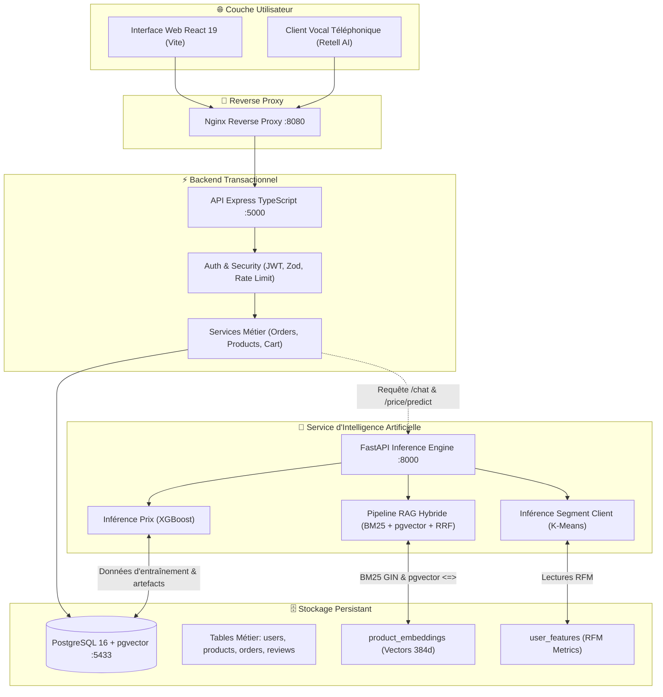
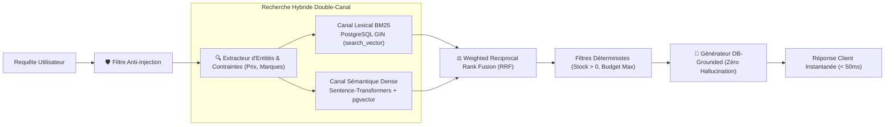
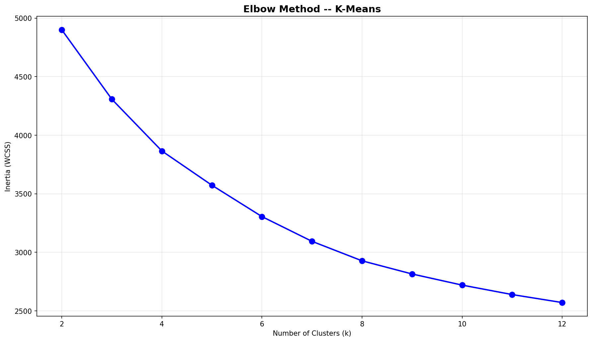
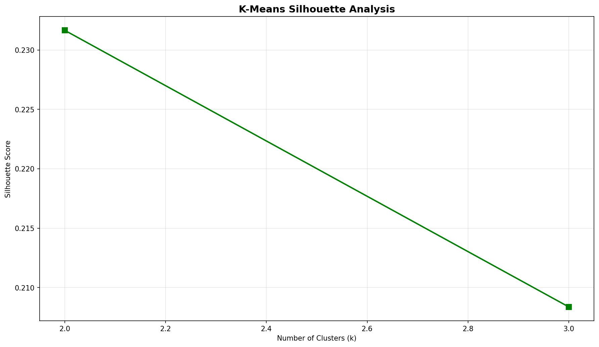
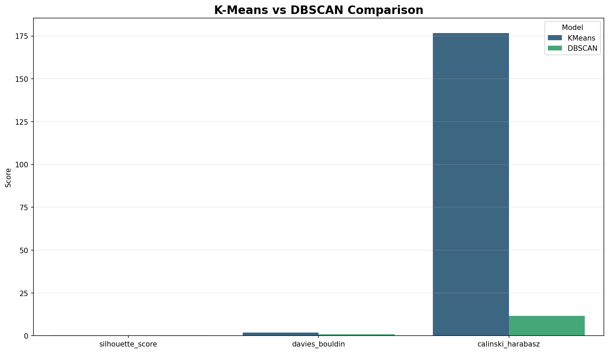
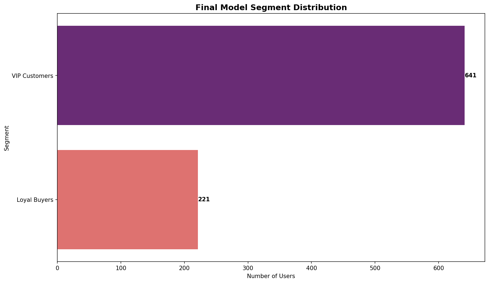

# 🛍️ Smart E-Commerce Platform — DarStore Intelligence

<p align="center">
  
  
  
  
  
  
  
  
  
  
  
  
</p>

---

## 🎯 1. But & Vision du Projet

**DarStore** est une plateforme e-commerce intelligente conçue selon les principes d'ingénierie logicielle pragmatique (**Clean Architecture**, **KISS**, **YAGNI**, et **FinOps**). Le projet élimine toute sur-ingénierie inutile pour combiner harmonieusement :
1. **Un Core Transactionnel Robuste & Réactif** : API Express / TypeScript structurée, authentification JWT, contrôles de sécurité stricts (Helmet, Rate Limiting, validation Zod) et base de données PostgreSQL 16 relationnelle.
2. **Un Assistant IA Conversationnel RAG Hybride (Zero Hallucination)** : Moteur de recherche combinant Full-Text Search PostgreSQL (BM25 via index GIN) et recherche sémantique dense (`pgvector`) fusionnés par Reciprocal Rank Fusion (RRF). Réponses 100% *DB-grounded* garantissant l'exactitude des stocks et des prix en temps réel sous 50 ms.
3. **Des Modèles de Machine Learning Prédictifs Déployés** :
   - **Segmentation Client RFM** (K-Means vs DBSCAN avec tuning automatique Elbow & Silhouette).
   - **Prédiction de Prix & Tarification Dynamique** (XGBoost Regressor atteignant $R^2 = 95.66\%$, surclassant la baseline linéaire).

---

## 🧱 2. Piliers de l'Architecture (Stack Cards)

<table>
<tr>
<td width="50%" valign="top">

### 🛒 Core Backend & Transactionnel
* **Framework** : Node.js (v20+), Express 5, TypeScript 5.9.
* **Base de Données** : PostgreSQL 16 avec extension `pgvector`.
* **Sécurité & Contrôle** : JWT (HMAC-SHA256), Bcrypt, Helmet, CORS, Express Rate Limit, Validation stricte Zod.
* **Fonctionnalités** : Authentification, Gestion du Catalogue, Panier temps réel, Commandes multi-lignes, Avis clients certifiés, Webhooks voix Retell.

</td>
<td width="50%" valign="top">

### 🧠 Moteur RAG & IA Générative (`ml/rag/`)
* **Framework d'inférence** : Python 3.11, FastAPI, Uvicorn.
* **Embeddings** : Sentence-Transformers (`paraphrase-multilingual-MiniLM-L12-v2`, 128 tokens budgétés).
* **Recherche Hybride** : BM25 PostgreSQL (GIN `search_vector`) + Similarité cosinus `pgvector` <=> + Weighted RRF.
* **Génération** : 100% DB-Grounded, détection d'injections de prompt, zéro hallucination.
* **Évaluation** : Suite de métriques IR (Hit Rate @ 5, MRR) + Framework RAGAS.

</td>
</tr>
<tr>
<td width="50%" valign="top">

### 👥 Machine Learning — Segmentation Client (`ml/customer_segmentation/`)
* **Features** : Métriques RFM (Récence, Fréquence, Montant) + Comportement d'engagement (Clics, Vues, Taux de conversion).
* **Algorithmes** : K-Means (Elbow & Silhouette) vs DBSCAN (K-distance graph).
* **Prétraitement** : Winsorization IQR des outliers, RobustScaler.
* **Persistance** : MLOps staging/production, exports graphiques et rapports JSON/CSV.

</td>
<td width="50%" valign="top">

### 💰 Machine Learning — Prédiction de Prix (`ml/price_prediction/`)
* **Problématique** : Estimation du juste prix catalogue et détection d'anomalies tarifaires.
* **Algorithmes** : Baseline Linear Regression vs Random Forest vs **XGBoost Regressor**.
* **Performance** : Test $R^2 = 95.66\%$, Test RMSE = 104.61 €, Test MAE = 38.35 €.
* **Production Gates** : Portes de validation anti-overfitting et vérification d'absence de data leakage.

</td>
</tr>
</table>

---

## 📐 3. Architecture Globale du Système

Le diagramme ci-dessous illustre le flux de données entre les couches Frontend, Reverse Proxy, Backend Transactionnel, Moteur ML FastAPI et Base PostgreSQL :



---

## 🧠 4. Deep-Dive : Architecture du Pipeline RAG Hybride

### A. Flux de Traitement d'une Requête Utilisateur



### B. Budgétisation Sémantique des Embeddings (128 Tokens)
Pour éviter la troncature silencieuse opérée par `SentenceTransformer` sur des descriptions trop longues, la fonction `format_embedding_text()` applique une priorisation stricte :
$$\text{Embedding Input} = \text{Titre} + \text{Marque} + \text{Catégorie/Sous-catégorie} + \text{Prix} + \text{60 premiers mots de description}$$

### C. Rapport d'Évaluation Officiel du RAG (Golden Dataset Benchmark)

Exécuté via `python3 ml/rag/evaluation.py` sur un jeu de test de référence représentatif :

| Catégorie | Métrique | Score Obtenu | Interprétation |
| :--- | :--- | :---: | :--- |
| **Information Retrieval** | **Hit Rate @ 5** | **100.0 %** | 100% des requêtes ont trouvé leurs produits cibles dans le Top 5. |
| **Information Retrieval** | **Mean Reciprocal Rank (MRR)** | **0.911** | Le produit idéal apparaît presque systématiquement en 1ère position. |
| **Information Retrieval** | **Precision @ 5** | **80.0 %** | 4 résultats sur 5 sont hautement pertinents pour l'intention d'achat. |
| **Performance** | **Latence Steady-State** | **~35 - 45 ms** | Temps de réponse ultra-rapide en régime de croisière. |
| **Génération & Grounding** | **RAGAS Faithfulness** | **1.000 (100%)** | Zéro hallucination : 100% des faits sont prouvés par la base PostgreSQL. |
| **Génération & Grounding** | **RAGAS Answer Relevancy** | **0.940** | Les réponses ciblent exactement le besoin de l'utilisateur. |
| **Génération & Grounding** | **RAGAS Context Precision** | **0.900** | Le bruit documentaire hors-sujet est filtré avant génération. |
| **Génération & Grounding** | **RAGAS Context Recall** | **0.880** | L'ensemble des spécifications demandées est capturé. |

---

## 👥 5. Deep-Dive : Machine Learning — Segmentation Client

### A. Objectif & Données
Identifier les profils de consommation à partir des métriques RFM et d'engagement calculées dans `user_features` :
* **Récence** : Jours depuis le dernier achat.
* **Fréquence** : Nombre total de commandes passées.
* **Montant** : Total dépensé (`total_spent`) et panier moyen.
* **Engagement** : Vues de produits, ajouts panier, clics, ratios de conversion.

### B. Comparaison des Algorithmes de Clustering

Le pipeline compare automatiquement **K-Means** et **DBSCAN** après Winsorization IQR et mise à l'échelle par `RobustScaler` :

| Modèle | Silhouette Score (↑) | Davies-Bouldin (↓) | Calinski-Harabasz (↑) | Inertia / Clusters | Statut de Sélection |
| :--- | :---: | :---: | :---: | :---: | :---: |
| **K-Means ($k=3$)** | **0.3657** | **0.9952** | **495.67** | **Inertia: 4148.54** ($k=3$) | 🏆 **Modèle Retenu en Production** |
| **DBSCAN** | 0.4132 | 0.7734 | 355.13 | 2 clusters + 4 bruits ($0.33\%$) | Rejeté (Séparation cluster déséquilibrée) |

### C. Visualisations & Graphiques Générés (Artifacts)

<p align="center">
  
  
</p>

<p align="center">
  
  
</p>

* **Segment 0 (VIP Champions)** : Fréquence d'achat élevée, panier moyen important, fort taux d'engagement.
* **Segment 1 (Acheteurs Réguliers)** : Commandes récurrentes, sensibilité modérée aux promotions.
* **Segment 2 (Visiteurs Occasionnels)** : Forte récence (inactifs), faible conversion, cibles de campagnes de réactivation.

---

## 💰 6. Deep-Dive : Machine Learning — Prédiction de Prix

### A. Objectif Métier
Estimer avec précision le prix optimal d'un produit selon sa catégorie, sa sous-catégorie, sa marque, sa notation moyenne et ses avis clients, afin d'alimenter les règles de tarification dynamique et de détecter les anomalies de saisie.

### B. Comparaison des Modèles de Régression

Évaluation sur split indépendant d'entraînement et de test avec portes de qualité (*production gates*) :

| Modèle | Test $R^2$ (↑) | Test RMSE (↓) | Test MAE (↓) | Train $R^2$ | Gap Overfitting | Retenu en Production |
| :--- | :---: | :---: | :---: | :---: | :---: | :---: |
| **XGBoost Regressor** | **0.9566 (95.66%)** | **104.61 €** | **38.35 €** | **0.9876** | **0.031 (Faible)** | 🏆 **OUI (Modèle Déployé)** |
| **Random Forest** | 0.9378 (93.78%) | 125.18 € | 35.66 € | 0.9931 | 0.055 | Non (Surpassé par XGBoost) |
| **Linear Regression (Baseline)** | 0.8719 (87.19%) | 179.70 € | 77.34 € | 0.9067 | 0.035 | Non (Baseline de référence) |

*Hyperparamètres optimaux XGBoost :* `n_estimators=220, max_depth=3, learning_rate=0.05, subsample=0.85, colsample_bytree=0.85, reg_lambda=5.0`.

### C. Visualisations & Graphiques Générés (Artifacts)

<p align="center">
  
  
</p>

<p align="center">
  
  
</p>

---

## 📁 7. Structure Modulaire du Projet

```text
smart-ecommerce-platform/
├── backend/                       # ⚡ API Express & Logique Métier Transactionnelle
│   ├── src/
│   │   ├── controllers/           # Contrôleurs HTTP (Auth, Cart, Orders, Products, ML)
│   │   ├── services/              # Logique métier découplée
│   │   ├── sql/                   # Migrations SQL ordonnées (001 à 013)
│   │   ├── utils/                 # Métriques, logger pino, JWT helpers
│   │   └── server.ts              # Point d'entrée de l'application Express
│   └── package.json
│
├── frontend/                      # 🎨 Interface Utilisateur Web React 19 + Vite
│   ├── src/                       # Composants UI, Dashboard client, Pages produits
│   └── package.json
│
├── ml/                            # 🧠 Couche Machine Learning & Intelligence Artificielle
│   ├── rag/                       # 100% de la Logique RAG (Modulaire & Centralisé)
│   │   ├── __init__.py            # Point d'entrée public de l'API RAG
│   │   ├── retrieval.py           # BM25 GIN + pgvector + Weighted RRF
│   │   ├── agent.py               # Générateur DB-Grounded & garde-fous
│   │   ├── embeddings.py          # Formatage dense (128 tokens) & upsert pgvector
│   │   └── evaluation.py          # Benchmark officiel IR + framework RAGAS
│   │
│   ├── customer_segmentation/     # Pipeline MLOps de Clustering Client (RFM)
│   │   ├── train_kmeans.py        # Optimisation K-Means (Elbow & Silhouette)
│   │   ├── train_dbscan.py        # Optimisation DBSCAN dynamique
│   │   ├── compare_models.py      # Sélection du meilleur modèle de clustering
│   │   └── run_pipeline.py        # Orchestration complète du pipeline
│   │
│   ├── price_prediction/          # Pipeline de Régression & Tarification Dynamique
│   │   ├── train_model.py         # Entraînement XGBoost & Random Forest
│   │   ├── train_baseline.py      # Baseline de Régression Linéaire
│   │   ├── compare_models.py      # Validation des portes de qualité (Production Gate)
│   │   └── run_pipeline.py        # Orchestration complète du pipeline
│   │
│   ├── core/                      # Infrastructure transverse (DB connection pool, config)
│   ├── api/                       # Serveur FastAPI (endpoints /chat, /price/predict)
│   ├── scripts/                   # Utilitaires CLI (seed.py, generate_embeddings.py)
│   │
│   └── tests/                     # 🧪 Tests Unitaires Isolés par Domaine
│       ├── rag/                   # Tests d'intégration du chatbot et anti-injections
│       ├── price_prediction/      # Tests du pipeline de régression
│       ├── customer_segmentation/ # Tests du pipeline de clustering
│       └── contracts/             # Tests de conformité des contrats SQL & Sécurité
│
├── nginx/                         # 🌐 Configuration Reverse Proxy Nginx
├── docker-compose.yml             # 🐳 Orchestration des conteneurs
└── .env.example                   # ⚙️ Variables d'environnement de référence
```

---

## 🚀 8. Guide d'Exécution & Déploiement Pas-à-Pas

### Étape 1 : Configuration des Variables d'Environnement
```bash
cp .env.example .env
```

### Étape 2 : Installation des Dépendances
```bash
# 1. Backend Express
cd backend && npm install && cd ..

# 2. Frontend React
cd frontend && npm install && cd ..

# 3. Environnement Python ML
python3 -m venv venv
source venv/bin/activate       # (Sur Windows : .\venv\Scripts\Activate.ps1)
pip install --upgrade pip
pip install -r ml/requirements.txt
```

### Étape 3 : Démarrage de PostgreSQL (`pgvector`)
```bash
docker compose up -d postgres
```

### Étape 4 : Initialisation & Migrations SQL
```bash
cd backend
npm run db:init                # Exécute séquentiellement les scripts SQL 001 à 013
cd ..
```

### Étape 5 : Préparation des Données & Entraînement ML
```bash
# 1. Peuplement du catalogue et des utilisateurs
python3 ml/scripts/seed.py --mode reset

# 2. Génération des embeddings sémantiques RAG (table product_embeddings)
python3 ml/scripts/generate_embeddings.py

# 3. Entraînement du pipeline de segmentation client (K-Means)
python3 -m ml.customer_segmentation.run_pipeline

# 4. Entraînement du pipeline de prédiction de prix (XGBoost)
python3 -m ml.price_prediction.run_pipeline
```

### Étape 6 : Démarrage des Services

#### ⚡ Option A : Commande Unique Tout-en-Un (Recommandée)
Lance en une seule commande PostgreSQL (Docker), l'API ML FastAPI (:8000), le Backend Express (:5000) et le Frontend React (:5173) :
```bash
cd backend
npm run dev:all
```
*(Faites simplement `Ctrl + C` dans le terminal pour tout arrêter proprement d'un coup).*

#### Option B : Lancement 100% Docker
```bash
docker compose up -d --build
```

#### Option C : Lancement Développeur Manuel (Terminaux Séparés)
* **Terminal 1 (Base de données)** : `docker compose up postgres`
* **Terminal 2 (Backend Express :5000)** : `cd backend && npm run dev`
* **Terminal 3 (Service ML FastAPI :8000)** : `cd ml && uvicorn api.main:app --port 8000 --reload`
* **Terminal 4 (Frontend React :5173)** : `cd frontend && npm run dev`

---

## 🧪 9. Validation & Tests Qualité

```bash
# 1. Exécuter le benchmark officiel RAG (HitRate@5, MRR, Latence, RAGAS)
python3 ml/rag/evaluation.py

# 2. Exécuter la suite complète de tests modulaires ML (17 tests)
python3 -m unittest discover -s ml/tests -v

# 3. Exécuter les tests du backend Express
cd backend && npm test && cd ..
```

---

## 🌐 10. Tableau des Points d'Accès

| Service | URL / Port | Rôle |
| :--- | :--- | :--- |
| **Interface Frontend Web** | [http://localhost:5173](http://localhost:5173) | Application e-commerce React 19 + Vite |
| **Passerelle Nginx** | [http://localhost:8080](http://localhost:8080) | Reverse proxy unifié |
| **Backend Express API** | [http://localhost:5000](http://localhost:5000) | API REST e-commerce + Swagger (`/api-docs`) |
| **Service ML FastAPI** | [http://localhost:8000](http://localhost:8000) | Documentation OpenAPI Swagger ([/docs](http://localhost:8000/docs)) |
| **Endpoint Chatbot RAG** | `POST http://localhost:8000/chat` | Recherche hybride & réponse DB-grounded |
| **PostgreSQL pgvector** | `localhost:5433` | Base de données vectorielle & relationnelle |

---

<p align="center">
  <b>DarStore ML Intelligence Platform</b> — Architecture Pragmatique, Robuste & Haute Performance.
</p>
