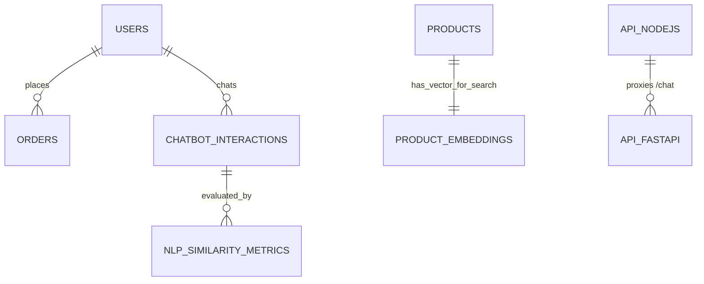

# 🚀 E-Commerce Intelligent Platform (Backend & Machine Learning Hybride)

Bienvenue dans l'architecture Backend et Intelligence Artificielle de la plateforme e-commerce. Ce projet est un environnement **hybride** mêlant logique métier stricte (Node.js) et pipeline de requêtes sémantiques ou génératives (Python FastAPI / LLMs / Algorithmes).

---

## 🏗️ Architecture du Projet

Le système s'articule autour de 3 piliers majeurs :

### 1. Backend API (Node.js / Express) dans `backend/`
- **`src/sql/`** : Source de vérité du schéma (001-010). Idempotent, contenant des configurations avancées et des tables spécifiques (`product_embeddings`, `chatbot_interactions`).
- **`src/services/`** : Logique métier (Commandes, Avis, etc.) dissociée des contrôleurs.
- **Sécurité et Scalabilité** : Zod pour la validation, JWT, Bcrypt, Helmet, et Rate Limiting centralisés.

### 2. Service NLP & APIs ML (Python / FastAPI) dans `ml/`
- **`api/main.py`** : Serveur d'inférence (FastAPI) écoutant sur le port 8000. Point d'entrée pour le Chatbot documentaire (endpoint `/chat`).
- **`nlp/chatbot/`** : Agent **RAG (Retrieval-Augmented Generation)** qui synthétise les recommandations produits en interrogeant la LLM (OpenAI par défaut). 
- **`nlp/retrieval/`** : Moteurs d'extraction hybride configurés pour interroger la base :
  - *DenseVectoreRetriever* : Recherche Sémantique par similarité Cosinus (via l'extension PostgreSQL `pgvector`).
  - *BM25Retriever* : Recherche Lexicale exacte.
- **`nlp_experiments/`** : Scripts d'automatisation des tests et benchmarks QA des modèles (Performance, Non-Regression, Overfitting).

### 3. Base de Données Hybride (PostgreSQL)
Fournie via Docker (`ecommerce_postgres`), la base intègre l'extension **pgvector** (`pgvector/pgvector:pg16`). Elle assure à la fois du transactionnel classique (Orders) et du stockage de vecteurs (Embeddings de 384 dimensions).

---

## 🎯 Schéma Relationnel & Traçabilité RAG

Cette architecture ne se contente pas de stocker des ventes, elle capture tout le processus décisionnel IA.


_Note: `chatbot_interactions` permet de retracer le contexte fourni par `pgvector` à l'IA, sécurisant et auditable (Traçabilité complète des hallucination)._

---

## 💾 Guide d'Exécution & Déploiement Local

### Étape 1 : Infrastructure
Démarrez la base de données (qui inclut nativement `pgvector`) :
```bash
cd backend/infra/docker
docker-compose up -d
```

### Étape 2 : Initialisation du Backend (Environnement Transactionnel)
```bash
cd backend
npm install
npm run db:init # ⚠️ Force-refresh : Réinstalle les 10 schémas SQL incluant les tables IA !
npm run dev     # Lance le backend Node.js (ex: http://localhost:5000)
```
_Astuce : Exécutez `npm run ml:seed:reset` depuis le package.json pour la génération automatisée initiale du catalogue._

### Étape 3 : Initialisation du Service ML (FastAPI & Agent)
```bash
cd ml
# Recommandé: Créez un Virtual Environnement
pip install -r requirements.txt
```

**⚠️ Configuration IA (Variable d'Environnement) :**
Pour que le Chatbot puisse répondre, configurez la clé OpenAI :
- **Windows PowerShell :** `$env:OPENAI_API_KEY="sk-votre-cle"`
- **Linux/Mac :** `export OPENAI_API_KEY="sk-votre-cle"`
*(Si la clé est absente, l'API passera en mode DÉMO sécurisé sans crasher).*

```bash
# Lancement de l'API ML
python api/main.py
```

---

## 🛡️ Audit de Qualité Effectué (Avril 2026)

Le Backend et le dossier ML respectent un cahier des charges strict vérifié par l'Agent QA :
1. **Node.js** : Utilisation stricte de Middlewares défensifs (compression, helmet, xss protection via lusca).
2. **Pydantic (Python)** : Validation en entrée du pipeline Machine Learning pour rejeter les injections (SQL Injection ou anomalies de payload).
3. **Prévention Overfitting** : Le `System Prompt` de l'agent Chatbot est encapsulé au niveau classe (`RAGChatbotAgent`) forçant les réponses à rester concentrées sur l'e-commerce avec des garde-fous "Hors-domaine".
4. **Performance Hybride** : Les architectures `Node` (I/O Lourd) et `Python` (Inférence/CPU lourds) sont correctement isolées et peuvent scaler séparément via microservice.

> [!NOTE]
> Pour des questions pointues concernant le stockage vectoriel ou les expérimentations algorithmiques, consultez le dossier expérimental `ml/nlp_experiments/`.
