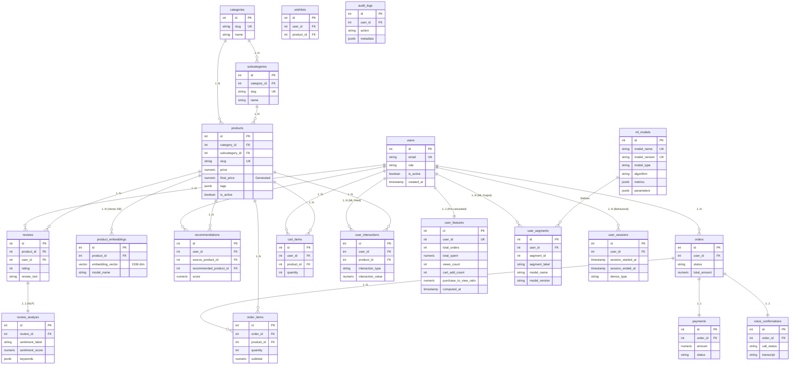

# 🚀 E-Commerce Intelligent Platform (Backend & ML Architecture)

Bienvenue dans la documentation officielle de l'architecture Backend et Data de la plateforme e-commerce intelligente. 
**[ 🛑 Ce README est un document de travail "Vivant" prévu pour évoluer au cours des 2 prochains mois ]**

Ce projet intègre une API robuste (TypeScript/Node) connectée à une base de données PostgreSQL avancée, spécialement conçue pour intégrer plus tard des modules de Machine Learning, NLP et de Système de Recommandation.

---

## 💾 Persistance et Docker (La règle d'or)

Ton conteneur PostgreSQL (`ecommerce_postgres`) est monté avec un **Volume Docker**. 

**🔥 Ce que ça signifie pour toi au quotidien pendant 2 mois :**
- **Non ! Tu n'as pas besoin de recréer les tables ou de réinsérer les données virtuellement à chaque fois que tu allumes ton PC.**
- Les **5000 produits** et les **milliers d'interactions** générés sont inscrits "en dur" sur ton disque dur.
- Quand tu fermes ou rallumes ton environnement Docker, ta base ressuscite exactement dans l'état où tu l'as laissée.

**L'unique commande à lancer quand tu allumes ton PC si Docker n'est pas démarré :**
```bash
docker start ecommerce_postgres
```

---

## 📊 Structure de la Base de Données (PostgreSQL)

Voici le schéma relationnel complet du Backend. Il est modulaire et optimisé via des Index et l'extension vectorielle (`pgvector`) pour les embeddings IA.



---

## 🧠 Infrastructure de Segmentation ML

Le système inclut un pipeline complet pour la segmentation automatique des utilisateurs.

### 1. Architecture du Pipeline
Le flux de données suit cette logique :
1.  **Agrégation** : La vue SQL `v_user_behavior_features` compile en temps réel les interactions, commandes, et avis.
2.  **Snapshot** : La table `user_features` stocke les statistiques calculées (récence, fréquence, montant, ratios de conversion).
3.  **Entraînement/Inférence** : Le moteur ML (futur) lit `user_features`.
4.  **Feedback** : Les résultats sont renvoyés via l'API dans `user_segments`.

### 2. Composants Backend
- **`MLService`** : Gère l'exécution des scripts SQL d'upsert et l'enregistrement des segments.
- **`MLController`** : Expose les endpoints pour déclencher le scan des données ou recevoir les résultats du modèle.
- **`mlRouter`** : Définit les routes `/api/admin/ml/...`.

### 3. Commandes Utiles (PowerShell / Bash)

**Initialiser / Mettre à jour toute la base (Recommandé) :**
```powershell
npm run db:init
```

**Recalculer manuellement les features utilisateurs (SQL pur) :**
```bash
docker exec -i ecommerce_postgres psql -U postgres -d ecommerce_ml_db < src/sql/009_ml_upsert.sql
```

**Vérifier les statistiques d'un utilisateur :**
```bash
docker exec -i ecommerce_postgres psql -U postgres -d ecommerce_ml_db -c "SELECT * FROM v_user_behavior_features LIMIT 5;"
```

**Gérer les données ML via NPM (Recommandé) :**
- `npm run ml:seed:reset` : Vide la base et génère 5000 produits/1500 users avec timestamps réalistes.
- `npm run db:7-ml-views` : Met à jour la vue analytique SQL.
- `npm run db:9-ml-upsert` : Recalcule et persiste les features dans `user_features`.

---

---

## 🛠️ Modifier l'Architecture (Pendant les 2 mois)

L'architecture divisée de `src/sql/` te permet de remplacer des pièces sans tout casser.

### Je veux Ajouter/Modifier/Supprimer une table SQL
Ne casse pas tout le schéma global ! Suis toujours cet ordre absolu si tu dois faire une modification dans les prochains mois :
1. **Édite `backend/src/sql/001_tables.sql`** : Modifie le `CREATE TABLE` / ajoute ta colonne.
2. **Édite `backend/src/sql/002_constraints.sql`** : Modifie ou désactive la Foreign Key/Check.
3. Puis, réinjecte manuellement les tables mises à jour dans Docker (seulement si tu as DROP la table avant !):
   *(Dans PowerShell depuis backend/infra/docker)*
   ```powershell
   Get-Content "..\..\src\sql\001_tables.sql" | docker exec -i ecommerce_postgres psql -U postgres -d ecommerce_ml_db
   Get-Content "..\..\src\sql\002_constraints.sql" | docker exec -i ecommerce_postgres psql -U postgres -d ecommerce_ml_db
   ```
*(Idem pour 003_indexes, 004_triggers ou 005_views selon tes besoins d'optimisation).*

### Je veux modifier/supprimer une table dans le générateur ML Data (`seed_data.py`)
Si par exemple tu décides de virer `audit_logs` ou `payments` le mois prochain pour te concentrer sur l'IA :
1. Supprime l'insertion SQL de la table dans **`001_tables.sql`**.
2. Ouvre `ml/seed_data.py`.
3. Retire le nom de la table du bloc SQL `TRUNCATE TABLE` dans la fonction `clear_tables()`.
4. Retire la table du dictionnaire `allowed_tables` dans la fonction `get_existing_ids()`.
5. Supprime complètement la fonction Python correspondante (ex: `seed_audit_logs`).
6. Enlève l'appel final de cette fonction dans le `main()`.

---

La plateforme possède un générateur de données synthétiques Python professionnel situé dans `/ml/seed_data.py`, capable de simuler **18 mois d'activité historique** avec des timestamps réalistes.

### Volumes actuels (Configurables dans `seed_data.py`)
- **Produits** : 5 000
- **Utilisateurs** : 1 500
- **Interactions** : ~26 000 (Vues, Clics, Paniers, etc.)
- **Commandes** : ~4 000 (avec historique chronologique par user)
- **NLP/IA** : ~75 000 reviews analysées et 3 000 embeddings vectoriels.

### J'ai besoin de PLUS de données (Mode APPEND)
*Ajoute de nouveaux produits et utilisateurs SANS effacer l'existant :*
```bash
# Depuis le dossier backend
npm run ml:seed:append
```

### J'ai cassé mon backend ou modifié mon schéma (Mode RESET)
*⚠️ Reconstruit une base propre avec 18 mois d'historique réaliste :*
```bash
# Depuis le dossier backend
npm run ml:seed:reset
```

---

## 🩺 Monitoring SQL au quotidien
Quelques commandes backend pour vérifier rapidement la santé de la Data depuis ton PC Windows :

**Voir combien d'enregistrements/lignes réelles existent par table :**
```bash
docker exec -i ecommerce_postgres psql -U postgres -d ecommerce_ml_db -c "SELECT relname AS table_name, n_live_tup AS row_count FROM pg_stat_user_tables ORDER BY n_live_tup DESC;"
```

**Rentrer dans la base (Terminal interactif Postgres) :**
```bash
docker exec -it ecommerce_postgres psql -U postgres
# Puis tape \dt pour voir les tables
# Puis tape \q pour sortir
```
