# Guide d'Architecture : Pipeline du Chatbot RAG 🤖

Ce document explique en détail le flux de données de votre système de chatbot, de la question de l'utilisateur jusqu'à la sauvegarde de l'historique en base de données PostgreSQL.

Le processus utilise l'architecture **RAG** (Retrieval-Augmented Generation) qui combine un moteur de recherche performant et une intelligence artificielle générative.

---

## 🗺️ Le Processus Global (Pipeline)

Voici ce qui se passe sous le capot **dès qu'un appel est fait** vers `POST /chat`.

```mermaid
sequenceDiagram
    participant Utilisateur
    participant FastAPI (main.py)
    participant Model Local (SentenceTransformer)
    participant Base SQL (pgvector)
    participant IA (OpenAI GPT)
    
    Utilisateur->>FastAPI: Envoie "{query: 'je cherche un iphone pas cher'}"
    
    rect rgb(20, 50, 70)
    note right of FastAPI: Étape 1 : Retrieval (Recherche Sémantique)
    FastAPI->>Model Local: Convertir phrase en Vecteur [0.12, -0.4, ...]
    Model Local-->>FastAPI: Renvoie le Vecteur (384 dimensions)
    FastAPI->>Base SQL: Chercher les produits les + proches du Vecteur
    Base SQL-->>FastAPI: Renvoie Top-3: "iPhone 12", "iPhone 13", "Chargeur"
    end
    
    rect rgb(70, 30, 70)
    note right of FastAPI: Étape 2 : Generation (Agent IA)
    FastAPI->>IA: Envoie le "System Prompt" + le contexte [iPhone 12, 13] + User Query
    IA-->>FastAPI: Génère une réponse structurée et commerciale
    end
    
    FastAPI-->>Utilisateur: Retourne le JSON {response: "..."}
    
    rect rgb(30, 60, 30)
    note right of FastAPI: Étape 3 : Traçabilité (Background Task)
    FastAPI-)Base SQL: INSERT INTO chatbot_interactions
    note right of Base SQL: Stocke la conversation sans bloquer l'utilisateur
    end
```



---

## 🛠️ Explication des 3 Étapes Clés

### 1. La Recherche Intelligente (Retrieval)
*Fichier : `ml/nlp/retrieval/vector_search.py`*

Quand l'utilisateur pose une question, le système ne cherche pas les mots exacts, il cherche le **sens**. 
1. Le texte est traduit en coordonnées mathématiques (un vecteur de 384 nombres) via le réseau de neurones local `all-MiniLM-L6-v2`.
2. Il se connecte à PostgreSQL (via `core/db.py`)
3. Il effectue cette requête magique `SELECT ... ORDER BY embedding_vector <=> %s`.
> L'opérateur `<=>` est la fonction Cosinus de pgvector, qui trouve les produits dont les caractéristiques ou la description mathématique se rapprochent le plus de la question.

### 2. La Génération de la Réponse (Agent LLM)
*Fichier : `ml/nlp/chatbot/agent.py`*

Le Chatbot est "aveugle" aux produits que vous avez, il ne connait que ce qu'on lui donne.
On lui donne donc le **Contexte** (les produits trouvés à l'étape 1) + la **Question** de l'utilisateur. 
Le moteur OpenAI GPT-4 lit ce contexte dicté par un *Système Prompt* très strict, qui l'oblige à :
- Interagir en français.
- Ne pas s'égarer s'il n'y a pas de produits correspondants.
- Pousser des recommandations marchandes sur le catalogue récupéré.

### 3. Le Stockage (Logging / Traçabilité)
*Fichiers concernés : `ml/api/main.py` et schéma `009_nlp_schema.sql`*

Une fois la réponse renvoyée au front-end, nous utilisons une magie de FastAPI : les **BackgroundTasks** (Tâches en arrière-plan).
Le code va ouvrir une session dans PostgreSQL sans faire attendre l'utilisateur, et faire l'INSERT métier.

#### Où est-ce stocké ? 
Dans la table SQL **`chatbot_interactions`**.

#### Que stocke-t-on exactement ?
- **user_query** : Ce que le client a tapé ("je cherche un iphone")
- **retrieved_context** : Format JSON listant les produits trouvés (pour déboguer l'algorithme)
- **retrieval_algorithm** : Nom de l'algo ('Dense_Cosine' ou 'BM25')
- **llm_prompt** : Les règles envoyées à l'IA avec la requête.
- **llm_response** : La réponse générée finale !

---

## 🗄️ Comment observer les réponses ?

Pour analyser ce qui s'est raconté entre les clients et le bot, allez dans votre gestionnaire de base de données (ex: pgAdmin) et exécutez la requête suivante :

```sql
SELECT 
    user_query    AS Question_Client, 
    llm_response  AS Reponse_Chatbot, 
    created_at    AS Date_Heure
FROM chatbot_interactions 
ORDER BY created_at DESC;
```
