# Guide d'Architecture : Pipeline du Chatbot RAG 🤖

Ce document explique en détail le flux de données de votre système de chatbot, de la question de l'utilisateur jusqu'à la sauvegarde de l'historique en base de données PostgreSQL.

Le processus utilise l'architecture **RAG** (Retrieval-Augmented Generation) qui combine un moteur de recherche hybride performant et une intelligence artificielle générative.

---

## 🗺️ Le Processus Global (Pipeline v2.0)

Voici ce qui se passe sous le capot **dès qu'un appel est fait** vers `POST /chat`.

```mermaid
sequenceDiagram
    participant Utilisateur
    participant FastAPI (main.py)
    participant BM25 (PostgreSQL FTS)
    participant Model Local (SentenceTransformer)
    participant Base SQL (pgvector)
    participant Fusion RRF
    participant IA (OpenAI GPT)
    
    Utilisateur->>FastAPI: Envoie "{query: 'je cherche un iphone pas cher'}"
    
    Note over FastAPI: Validation (1-500 chars) + Session UUID
    
    rect rgb(20, 50, 70)
    note right of FastAPI: Étape 1 : Recherche Hybride (BM25 + Sémantique)
    
    FastAPI->>BM25: Recherche lexicale via plainto_tsquery('french', query)
    BM25-->>FastAPI: Résultats BM25 (titre + description + marque)
    
    FastAPI->>Model Local: Convertir phrase en Vecteur (384D multilingue)
    Model Local-->>FastAPI: Renvoie le Vecteur
    FastAPI->>Base SQL: Chercher les produits proches via pgvector <=>
    Base SQL-->>FastAPI: Résultats Vector (similarité cosinus)
    
    FastAPI->>Fusion RRF: Fusionner BM25 + Vector via Reciprocal Rank Fusion
    Fusion RRF-->>FastAPI: Top-5 produits (enrichis: prix, marque, stock, note)
    end
    
    rect rgb(70, 30, 70)
    note right of FastAPI: Étape 2 : Génération IA (Agent RAG)
    Note over FastAPI: Détection d'injection de prompt
    FastAPI->>IA: System Prompt + Contexte Enrichi + User Query
    IA-->>FastAPI: Réponse commerciale structurée
    end
    
    FastAPI-->>Utilisateur: Retourne le JSON {response, context_used, session_id}
    
    rect rgb(30, 60, 30)
    note right of FastAPI: Étape 3 : Traçabilité (Background Task)
    FastAPI-)Base SQL: INSERT INTO chatbot_interactions (prompt complet logué)
    note right of Base SQL: Stocke la conversation sans bloquer l'utilisateur
    end
```



---

## 🛠️ Explication des 3 Étapes Clés

### 1. La Recherche Hybride (Retrieval)

Le système utilise **deux moteurs de recherche complémentaires** fusionnés via **Reciprocal Rank Fusion (RRF)** :

#### a) BM25 — Recherche Lexicale
*Fichier : `ml/nlp/retrieval/bm25_search.py`*

- Utilise `plainto_tsquery('french', ...)` pour une recherche plein texte sécurisée
- Cherche dans `title`, `description`, et `brand` (via colonne `search_vector` pré-calculée)
- Index GIN pour des performances optimales
- **Force** : Excellent sur les noms exacts (ex: "iPhone 12 Pro Max", "Samsung Galaxy")

#### b) Dense Vector — Recherche Sémantique
*Fichier : `ml/nlp/retrieval/vector_search.py`*

- Modèle **multilingue** : `paraphrase-multilingual-MiniLM-L12-v2` (384 dimensions)
- Supporte le français, l'anglais, et 50+ langues
- Utilise pgvector avec index HNSW et opérateur de distance cosinus `<=>`
- **Force** : Comprend l'intention (ex: "un portable avec bonne batterie" → smartphones)

#### c) Fusion RRF — Le Meilleur des Deux Mondes
*Fichier : `ml/nlp/retrieval/hybrid_search.py`*

- Formule : `score(d) = Σ 1 / (60 + rang(d))` pour chaque document dans chaque liste
- Les produits présents dans les deux listes obtiennent un score cumulé
- Fallback automatique : si un des moteurs échoue, l'autre prend le relais

#### d) Filtres Métier
Tous les retrievers appliquent automatiquement :
- `is_active = TRUE` — Pas de produits désactivés
- `stock > 0` — Pas de produits en rupture

#### e) Données Enrichies
Chaque résultat contient : `name`, `brand`, `price`, `final_price`, `description`, `rating_avg`, `stock`, `score`, `source`.

### 2. La Génération de la Réponse (Agent LLM)
*Fichier : `ml/nlp/chatbot/agent.py`*

Le Chatbot est "aveugle" aux produits que vous avez, il ne connait que ce qu'on lui donne.
On lui donne donc le **Contexte Enrichi** (les produits trouvés avec prix, marque, stock, note, description) + la **Question** de l'utilisateur.

**Sécurité :**
- Détection d'injection de prompt (patterns regex FR + EN)
- Entrée utilisateur encadrée par des balises `<user_query>` pour isoler du system prompt
- Système Prompt strict qui interdit les réponses hors domaine

**Dégradation gracieuse :**
- Sans clé API → Mode démo avec réponse basée sur les données produits
- Erreur LLM → Réponse de secours avec les noms des produits trouvés

### 3. Le Stockage (Logging / Traçabilité)
*Fichiers concernés : `ml/api/main.py` et schéma `009_nlp_schema.sql`*

Utilise les **BackgroundTasks** FastAPI pour un logging non-bloquant.

#### Que stocke-t-on ?
- **user_query** : Ce que le client a tapé
- **retrieved_context** : Les produits trouvés (JSON complet avec prix, stock, etc.)
- **retrieval_algorithm** : `Hybrid_RRF`
- **llm_prompt** : Le prompt **COMPLET** (system prompt + contexte enrichi + question)
- **llm_response** : La réponse générée finale
- **session_id** : UUID unique par conversation (support multi-tour)

---

## 🗄️ Comment observer les réponses ?

```sql
SELECT 
    session_id        AS Session,
    user_query        AS Question_Client, 
    retrieval_algorithm AS Algorithme,
    llm_response      AS Reponse_Chatbot, 
    created_at        AS Date_Heure
FROM chatbot_interactions 
ORDER BY created_at DESC;
```

---

## 🧪 Tests QA

Le fichier `test_chat.py` contient **35+ scénarios pytest** couvrant :
- Requêtes nominales, courtes, vagues
- Injection SQL et prompt
- Spam, caractères spéciaux, emojis
- Fautes d'orthographe, synonymes, langues mixtes
- Contraintes budgétaires, comparaisons, multi-intention
- Validation de la structure de réponse
- Vérification du logging en base

```bash
# Lancer les tests
cd ml
pytest test_chat.py -v
```
